# Computer Graphics OpenGL Setup

A ready-to-use OpenGL (FreeGLUT) project for the Computer Graphics course.
FreeGLUT is already inside the project, so you don't need to install or set up anything in Code::Blocks.
Just open the project, write your code in `main.cpp` and run.

It also has **17 small example programs** (points, lines, shapes, colors, transformations, animation, keyboard, DDA, Bresenham and more) that you can run one by one.

**Semester:** Summer 2025-2026

## Requirements

- **Windows**
- **Code::Blocks with MinGW** – download the `mingw-setup` version from [codeblocks.org](https://www.codeblocks.org/downloads/binaries/)
- (Optional) **VS Code** with the **C/C++** extension

## Clone the Project

```bash
git clone https://github.com/munshi-rishad/ComputerGraphics-OpenGL-Setup.git
```

## Run in Code::Blocks (easiest)

1. Open `openglportable-64bit/openglportable/openglportable.cbp` in Code::Blocks.
2. Press **F9** (Build and run).
3. A window opens with a white circle. Your setup is working.

## Run in VS Code

1. Install the MinGW compiler (the Code::Blocks `mingw-setup` installer gives it) and add
   `C:\Program Files\CodeBlocks\MinGW\bin` to the Windows `PATH`. Check with `g++ --version`.
2. Open the cloned folder in VS Code and open a terminal (**Terminal → New Terminal**).
3. Build and run:

   ```bash
   cd openglportable-64bit/openglportable
   g++ main.cpp -I../freeglut/include -L../freeglut/lib/x64 -lfreeglut -lopengl32 -lglu32 -o bin/Debug/openglportable.exe
   cd bin/Debug
   ./openglportable.exe
   ```

## How to Try the Examples

1. Open any file in the `examples` folder (for example `examples/06_circle.cpp`).
2. Copy all of its code.
3. Paste it into `openglportable-64bit/openglportable/main.cpp`, replacing everything.
4. Press **F9**.

To write your own program, start from `examples/14_basic_structure.cpp`.

## Project Structure

```
ComputerGraphics-OpenGL-Setup/
├── openglportable-64bit/
│   ├── freeglut/            # FreeGLUT headers, libraries and DLL (already set up)
│   └── openglportable/
│       ├── main.cpp         # write your code here
│       ├── openglportable.cbp   # Code::Blocks project
│       └── bin/Debug/       # freeglut.dll (the .exe is created here)
├── examples/                # 17 ready programs
└── screenshots/             # output of each example
```

## Examples and Output

Each example file is in the `examples` folder (`01_point.cpp`, `02_line.cpp`, ...). `14_basic_structure.cpp` is an empty template, so it has no picture.

<table>
  <tr>
    <td width="50%" align="center">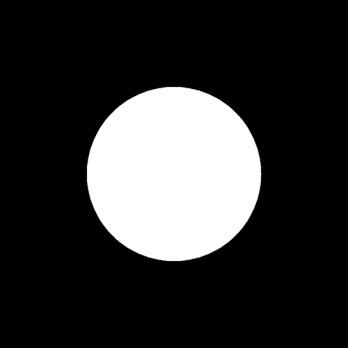<br><sub>Starter (main.cpp) – white circle</sub></td>
    <td width="50%" align="center">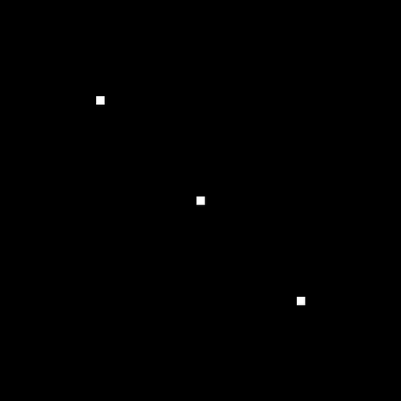<br><sub>1. Point – GL_POINTS</sub></td>
  </tr>
  <tr>
    <td width="50%" align="center">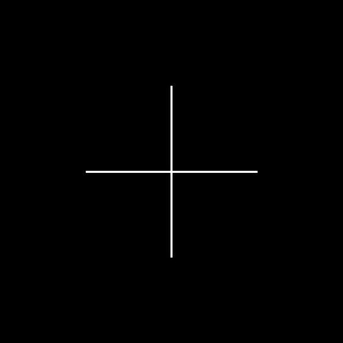<br><sub>2. Line – GL_LINES</sub></td>
    <td width="50%" align="center">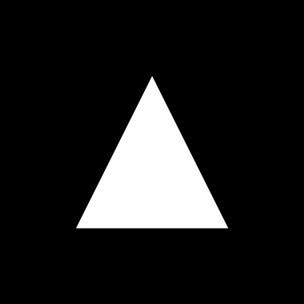<br><sub>3. Triangle – GL_TRIANGLES</sub></td>
  </tr>
  <tr>
    <td width="50%" align="center">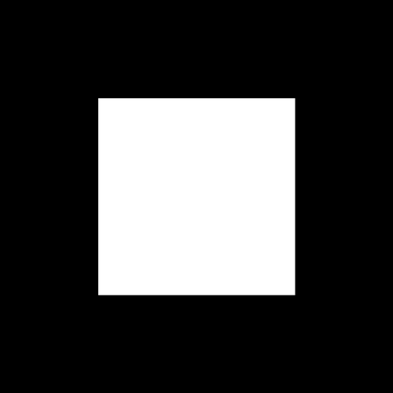<br><sub>4. Rectangle – GL_POLYGON</sub></td>
    <td width="50%" align="center">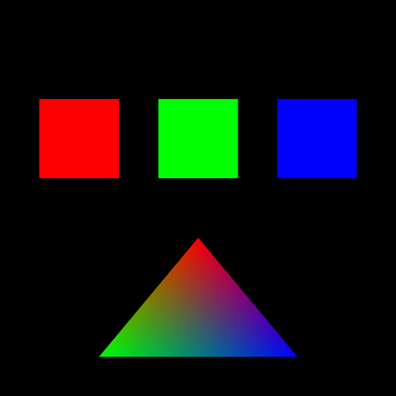<br><sub>5. Colors – glColor3f</sub></td>
  </tr>
  <tr>
    <td width="50%" align="center">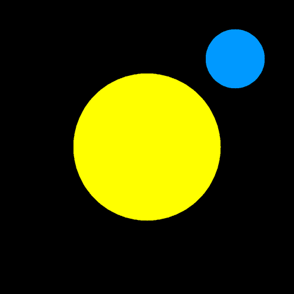<br><sub>6. Circle – cos and sin</sub></td>
    <td width="50%" align="center">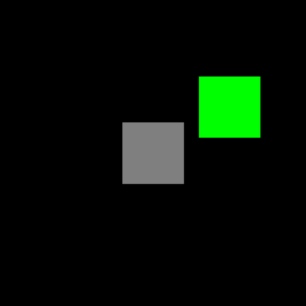<br><sub>7. Translation – glTranslatef</sub></td>
  </tr>
  <tr>
    <td width="50%" align="center"><br><sub>8. Rotation – glRotatef</sub></td>
    <td width="50%" align="center">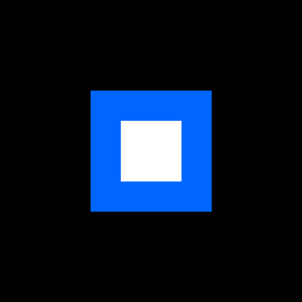<br><sub>9. Scaling – glScalef</sub></td>
  </tr>
  <tr>
    <td width="50%" align="center">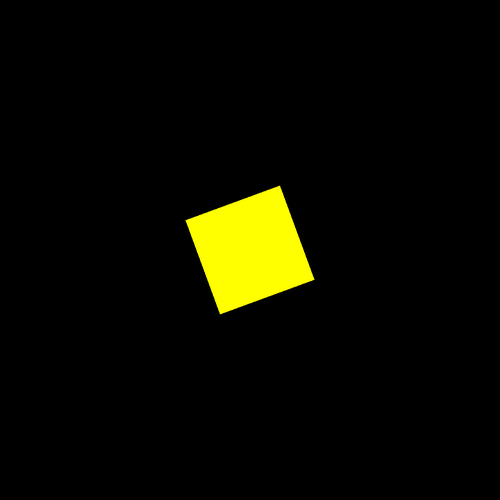<br><sub>10. Timer animation – rotating square</sub></td>
    <td width="50%" align="center">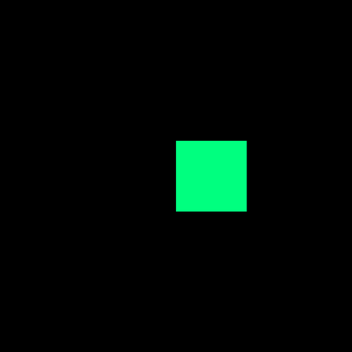<br><sub>11. Keyboard – move with arrow keys</sub></td>
  </tr>
  <tr>
    <td width="50%" align="center">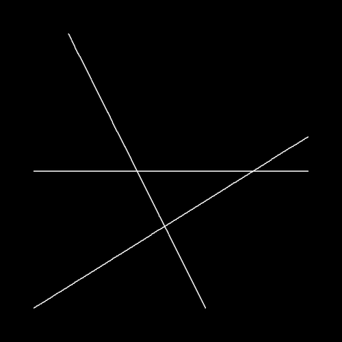<br><sub>12. DDA line algorithm</sub></td>
    <td width="50%" align="center">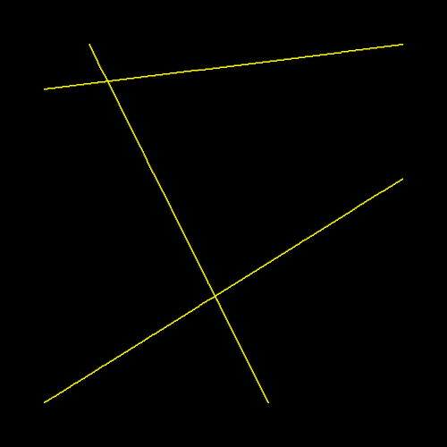<br><sub>13. Bresenham line algorithm</sub></td>
  </tr>
  <tr>
    <td width="50%" align="center">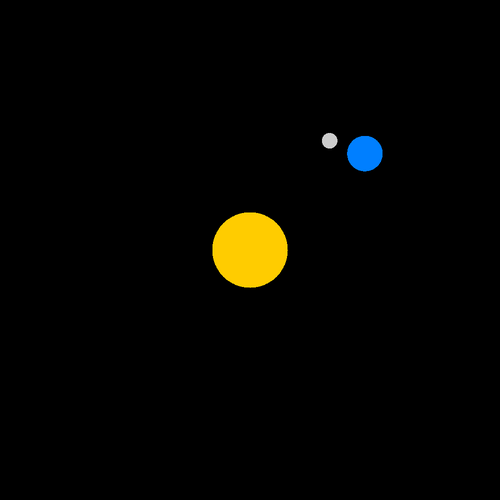<br><sub>15. Planet system – sun, planet and moon</sub></td>
    <td width="50%" align="center">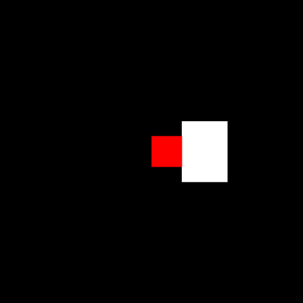<br><sub>16. Collision – box turns red when it touches</sub></td>
  </tr>
  <tr>
    <td width="50%" align="center">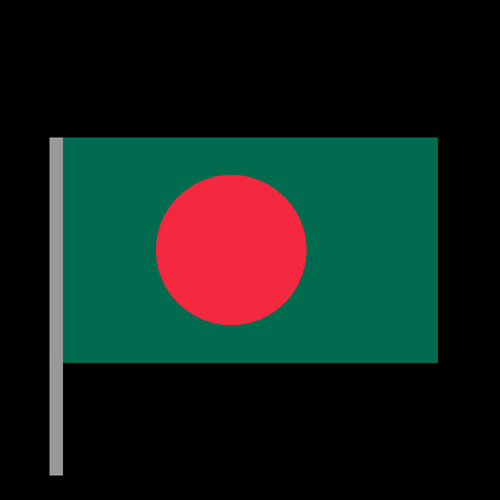<br><sub>17. Flag of Bangladesh</sub></td>
    <td width="50%"></td>
  </tr>
</table>

